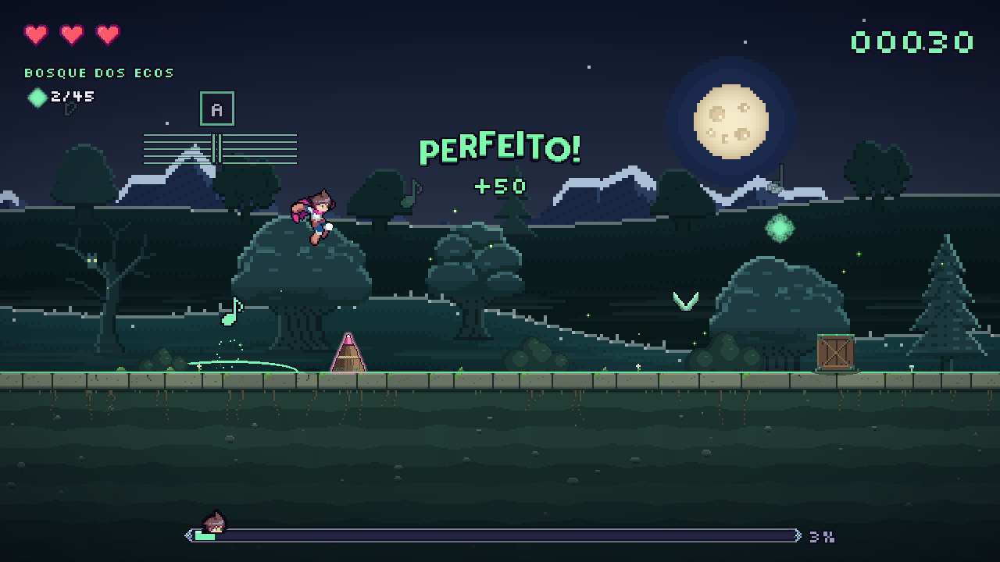
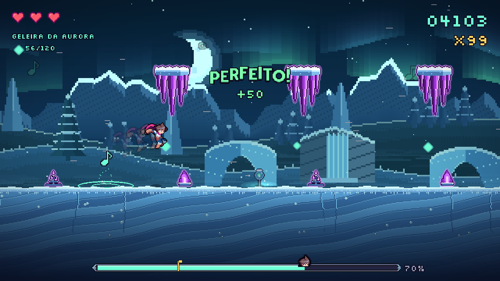

# Game Design Document — Rhythm Striker

## 1. Nome do Projeto

Rhythm Striker — jogo de plataforma rítmico 2D para PC, desenvolvido em Python com o
pygame-ce e a biblioteca Power PPlay 2.0, do IC-UFF, por uma equipe de 2 pessoas, Matheus
Castro e Henrique Mendes. Single-player, com 5 fases e cerca de 8 minutos de jogo.
O jogo é aberto pelo arquivo `main.py`, depois de instaladas as dependências do
`requirements.txt`.

## 2. High Concept

Rhythm Striker é um jogo de plataforma 2D de rolagem lateral em que o jogador foi
teleportado para uma dimensão feita de som e só consegue avançar se pular na batida das
músicas. O Léo corre sozinho para a direita, na velocidade da música, e o jogador decide
apenas quando pular. Cada fase é escrita como uma partitura, e cada obstáculo fica
exatamente onde um pulo dado na batida certa passa por cima dele. O diferencial é que,
diferente de jogos tradicionais em que o jogador tem apenas uma tentativa para completar
as fases, o jogador tem três corações, e errar o tempo de um pulo custa apenas pontos. De
acordo com o timing de seus pulos, ele acumula pontuação e, ao completar a fase, recebe uma
nota que mostra se performou bem ou mal.

## 3. Gameplay e Enredo

Léo joga videogame de madrugada quando é teleportado da sua casa no exato momento em que
aperta o botão de START. Ele é sugado para dentro da tela e cai em **Rhythm Kingdom**, uma
dimensão alternativa que abriga os sons mais sinistros e viciantes do universo, não
reconhecidos como música, onde quem se move fora do compasso vira ruído e desaparece. Para
voltar para casa, ele precisa atravessar cinco mundos pulando em cima da batida, do Bosque
dos Ecos até a Cidadela do Eclipse, cujo portal final o leva de volta. O jogo abre
contando esse começo: uma cena mostra o Léo no quarto às 03:12, com o Rhythm Striker na TV,
pensando "só mais uma fase..." antes de apertar START e ser puxado para dentro da tela,
que vira a tela inicial do jogo. Quando o jogador vence os cinco mundos, uma cena final
faz o caminho de volta: a câmera sai de dentro da tela de resultado, que era a TV do
quarto, agora às 06:00, com o sol nascendo; a TV devolve o Léo, que pensa "...casa." e
desliga o videogame, dizendo que chega de jogo por hoje. Em seguida vêm os créditos, com
"obrigado por jogar!".

O jogo tem um foco absoluto: o jogador pular (Espaço, seta para cima, W, clique do mouse ou
o botão A do controle) nos momentos certos, dentro da janela da batida. A fase abre parada,
com o Léo de pé na largada, e só começa quando o jogador aperta Espaço. O tempo que o botão
fica apertado decide a altura do pulo: um toque rápido dá um pulo baixo, e segurar até o
alto do arco dá o pulo inteiro. Os dois pousam no mesmo lugar, na batida seguinte. Para que
o pulo nunca brigue com o ritmo, um toque dado com o Léo ainda no ar fica guardado e sai no
pouso, e há uma pequena tolerância de 40 ms para pular depois de sair da beirada.

Acertar dentro de um décimo de batida vale o Perfeito! e 50 pontos; até dois décimos antes
ou depois, vale Bom! e 25 pontos; deixar a janela passar sem tocar é Errou…, e o jogador não
ganha nenhuma pontuação. As janelas são medidas em fração da batida, então ficam mais
curtas nas músicas mais rápidas, e são propositalmente largas porque a latência de áudio do
Pygame não permite ser rigoroso. Acertos seguidos formam uma sequência (combo), e tocar
fora da partitura não pune.

Errar o tempo custa apenas pontos, nunca um coração. O coração se perde quando o Léo bate
em alguma coisa: num caco (o espinho de ruído), num bloco solto, na parede de um degrau,
num enxame ou num pingente. Depois de uma batida, ele fica um instante invulnerável,
piscando. Cair num fosso é o fim na hora, e com os três corações perdidos vem o fim de
jogo, em que o Léo se desfaz em ruído. Chegando ao fim da música, ele entra no portal do
mundo e a fase está completa.

As fases são montadas por um construtor rítmico que traduz uma partitura de batidas em
geometria: cacos, blocos e fossos pedem um pulo; degraus sobem e descem o caminho; ilhas
mudam a altura da outra margem. A mola é uma placa de luz que lança o salto grande, de duas
batidas no ar, por cima de torres, abismos ou até o alto de um paredão, e o orbe é um anel
de luz no alto desse salto, em que um toque dá um novo pulo no ar. Os portais de velocidade
seguem a música: o dourado acelera a corrida no drop, e o azul a devolve ao normal ou, na
Cidadela, a freia durante a quebra. As passarelas criam dois caminhos: o pulo inteiro sobe
nelas, e o toque rápido segue pelo chão. No alto do arco de boa parte dos pulos flutuam os
ecos, colecionáveis que valem pontos de bônus e premiam quem escolhe a altura certa do
pulo. A primeira vez de cada mecânica numa fase vem com uma legenda escrita no próprio
mundo.

São 5 fases, cada uma construída sobre uma música e com a sua novidade. O Bosque dos Ecos,
fácil, a 84 BPM, é a fase que ensina: tudo se passa com toques rápidos, e é a única com
guias mostrando onde pular. As Dunas do Chocalho, moderada, a 96 BPM, tiram as guias e
trazem os enxames, que pairam sobre o chão nas pausas da música e só ferem quem pula,
ensinando que o silêncio também é nota. As Ilhas Suspensas, normal, a 110 BPM, são uma
corrida de pedra em pedra entre ilhas flutuantes. Nelas, os portais de velocidade, que no
Bosque só aparecem na reta final, passam a acompanhar o drop e a quebra da música, e surge
a primeira versão dos pingentes, cristais rubros pendurados de lajes de pedra, que só
deixam passar o toque rápido. A Geleira da Aurora, avançada, a 128 BPM, faz dos pingentes de gelo
o seu desafio principal, e a altura do pulo passa a fazer parte do ritmo.
Por fim, a Cidadela do Eclipse, difícil, a 150 BPM, onde o jogador é testado ao seu limite,
com muralhas, fossos em fila e a corrida mais rápida do jogo, para que Léo consiga, de uma
vez por todas, voltar para sua casa. Cada fase é montada sobre uma grade rítmica com
introdução, parte A, parte B e repetição variada da parte A, e dura de 1min27s a 1min46s. O
elenco é mínimo: Léo, e o mundo que ele precisa superar para ver sua família novamente.

As fases já tiveram de 2min11s a 2min30s, e jogando percebemos que ficavam longas e
maçantes, principalmente a primeira. Revisamos cada uma: o Bosque, que é a fase que ensina,
passou a ser a mais curta; as partes de cada música ficaram com uma coisa nova por vez, sem
repetir o mesmo desenho; a parte A' deixou de copiar a parte A e virou o clímax da fase; e
as corridas ganharam respiro, com no máximo 12 pulos iguais seguidos. A Cidadela ganhou uma
curva própria, com a quebra de fato mais calma e, no fim, uma prova que mistura o que cada
mundo ensinou, e na Geleira o começo do A' segue a melodia do sino: cada nota aguda é um pulo
livre, e cada nota grave, um toque curto por baixo dos pingentes.

Como segurar o botão faz o Léo pular de novo a cada pouso, revisamos as fases para que
ninguém atravesse um trecho longo só segurando. Sem tirar nenhum pulo das batidas da
música, o construtor das fases procura os trechos em que segurar bastaria e, a cada dez
batidas no máximo, coloca ali um "não pule" nas batidas vazias ou troca um pulo por um "só
um toque". Cada mundo tem os seus: as revoadas e os cristais nas Ilhas, os morcegos de gelo
na Geleira, e os morcegos de brasa e os espetos da grade levadiça na Cidadela. O Bosque
fica de fora, porque nele segurar não repete o pulo. Depois disso, o maior trecho que se
passa segurando caiu de até 98 batidas para no máximo 17, e o jogador que só segura se fere
nas primeiras batidas da fase.

## 4. Interface de Usuário

O HUD é mínimo, porque em jogo de ritmo o olhar fica à frente do personagem. No canto
superior esquerdo ficam os três corações do Léo, o nome da fase e a conta de ecos; no
superior direito, a pontuação e, a partir de três acertos seguidos, o combo. No centro da
tela aparece o julgamento da última ação (Perfeito!, Bom! ou Errou…), junto com a
pontuação ganha, sumindo em menos de um segundo. No rodapé fica a progressão do personagem
no mapa, numa barra com o rostinho do Léo andando por ela, uma marca do melhor progresso já
alcançado e a porcentagem ao lado.

A música também aparece escrita no próprio jogo, em sinais de partitura em pixel art. A
cada acerto, uma nota sobe da cabeça do Léo: no Perfeito!, uma colcheia, duas colcheias
ligadas ou um acorde, na cor do mundo; no Bom!, uma semínima amarela; e, a cada marco da
sequência, uma clave de sol. No mapa, a largada tem uma pauta com a clave de sol, o
compasso 4/4 e o andamento da música (semínima = BPM). O começo de cada parte da música
tem a sua letra de ensaio (A, B e A'), numa caixa sobre a barra dupla, e antes do portal
vem a barra final. No céu, notas, mínimas, sustenidos e bemóis flutuam devagar, ao fundo.

O jogo abre com a cena do Léo sendo puxado pela TV e fecha, depois do último mundo, com a
cena da volta para casa e os créditos (qualquer tecla pula as duas). Entre elas, há
as telas de menu, opções, seleção de fase, gameplay (com o menu de pausa) e resultado, mais
a de game over. O menu mostra o logo, o lema "um botão, cinco mundos, no ritmo" e quantos
mundos o jogador já venceu, com o total de pontos. As opções guardam apenas o volume da música. Na seleção, cada
fase é uma carta na moldura do seu mundo, com uma amostra do cenário, o emblema, a
dificuldade, o BPM, a melhor nota, o melhor progresso, o recorde de pontos, os ecos e a
música, e o fundo da tela muda para o mundo escolhido. A tela de resultado mostra a nota da
fase (S a partir de 95% de precisão, A a partir de 85%, B a partir de 70%, C abaixo disso),
de acordo com a pontuação total, além da contagem de acertos, da maior sequência e dos
ecos. Os recordes de cada fase ficam salvos no computador, e um recorde nunca piora.

A troca entre telas é suave: a tela escurece, troca e clareia de novo. Painéis, botões,
molduras, corações, letreiros de julgamento, medalhas de nota e o logo são imagens em pixel
art, e todos os textos usam uma única fonte pixelada, a Silkscreen. O jogo é desenhado em
1280x720, abre em tela cheia e roda estável a 60 quadros por segundo.

## 5. Áudio e Música

As trilhas foram selecionadas de acordo com a fase do jogo, sendo cada uma única, com o
critério de serem dinâmicas, eletrônicas, com BPM constante e previsível e bem marcadas.
Três delas são da NoCopyrightSounds, de licença livre: "Cruising", de Dosi & Aisake, no
Bosque; "Castle", de Clarx & Harddope, nas Ilhas; e "Ark", de Ship Wrek & Zookeepers, na
Cidadela. As duas fases que entraram depois, as Dunas e a Geleira, ganharam trilhas
originais, compostas por nós já na grade de batidas da fase: "Chocalho das Dunas", com
bordão, chocalho e alaúde, e "Aurora de Cristal", um trance de cristal. Para as fases
ficarem mais curtas, as trilhas originais foram recompostas numa forma menor, e das três
faixas da NoCopyrightSounds tiramos compassos inteiros, emendando o resto na batida forte,
sem mudar o andamento. Cada fase entra num compasso escolhido da sua faixa, para que as
partes da música, como o drop e a quebra, coincidam com as partes da fase, e os créditos
aparecem na largada, na seleção e no resultado. O jogo também tem efeitos sonoros próprios
para cada tipo de acerto e de ação, como o acerto perfeito, o acerto bom, o erro, o pulo, o
bloco quebrando, o eco, a mola, o orbe, a vitória, a morte e a navegação nos menus.

## 6. Arte Conceito e Referências

A direção de arte é de pixel art sobre fundos coloridos, com uma paleta própria para cada
mundo, e as peças de jogo são tingidas com ela. A regra de leitura nunca é quebrada: o que
machuca é sempre pontiagudo e na cor de perigo do mundo, o chão seguro é sólido e contínuo,
e o cenário de fundo fica afastado e menos contrastado. Os sinais de partitura seguem a
mesma regra: ficam altos, acima de qualquer pulo, translúcidos, nunca na cor de perigo e
não colidem com nada. O Bosque tem lua cheia, morros e um caminho de lajes com musgo; as
Dunas, sol forte, pirâmides e areia em camadas; as Ilhas, sol baixo e ilhas de pedra sobre
um mar de nuvens; a Geleira, aurora, picos nevados e gelo; e a Cidadela, um sol eclipsado
sobre muralhas violeta. Os cenários são desenhados em 320x180 e ampliados quatro vezes,
para ficarem pixelados, com camadas em parallax e partículas próprias de cada mundo, como
vaga-lumes, areia, neve e brasas, que mudam junto com as partes da música.

O Léo vem da folha de sprites gratuita Male Hero, da Ozzbit Games, e o Léo de pijama da
cena de abertura foi desenhado para o jogo. O total de assets é de cerca de 390 imagens,
entre cenários, peças de jogo, interface e animações, quase todas pintadas por código, por
geradores que escrevemos para isso.

As referências principais são **Geometry Dash**, pela fase como corrida sincronizada, pela
leitura visual do cenário em alta velocidade e pela indicação do progresso em porcentagem,
e **Rhythm Heaven**, por ensinar ritmo através de antecipação em vez de tutorial em texto.

## 7. Ideias Adicionais e Observações

O desenvolvimento do nosso jogo foi focado em entregar a base de forma sólida e jogável, e
ela acabou indo além do que planejamos. A previsão de 3 fases virou 5, e o pulo duplo, que
era um extra, entrou na forma do orbe. Algumas ideias mudaram no caminho: errar o tempo
custava um coração e passou a custar só os pontos, e o coração ficou para as batidas em
obstáculos; os personagens Eco, Estática e Metrônomo deram lugar aos
obstáculos de cada mundo; e as formas geométricas em ciano e magenta deram lugar à pixel
art, com uma paleta por mundo. Os cenários, que víamos como uma das nossas possíveis
dificuldades, foram resolvidos pintando a arte por código.

Para manter as fases justas, um robô joga cada uma delas com a física real do jogo, com
toques perfeitos, adiantados, atrasados, alternando adiantado e atrasado e sorteados dentro
da janela do Bom!, e confirma que nenhum deles leva dano; nas rotas duplas, ele ainda testa
cada par de pulos longos seguidos, adiantados e atrasados, e avisa quando um salto começa
entre dois tiles, onde o obstáculo fica fora do alto do arco. Uma segunda ferramenta mede,
para cada ação da fase, por quantas batidas o jogador passaria só segurando o botão a
partir dali. Outra mede o custo de cada quadro, para garantir os 60 quadros por segundo.
Também produzimos um trailer em 4K, de 1min28s, que conta o enredo em três atos com o jogo
rodando de verdade: o Léo sendo puxado pela TV, a travessia dos cinco mundos e a volta para
casa, com a nota S na tela.
